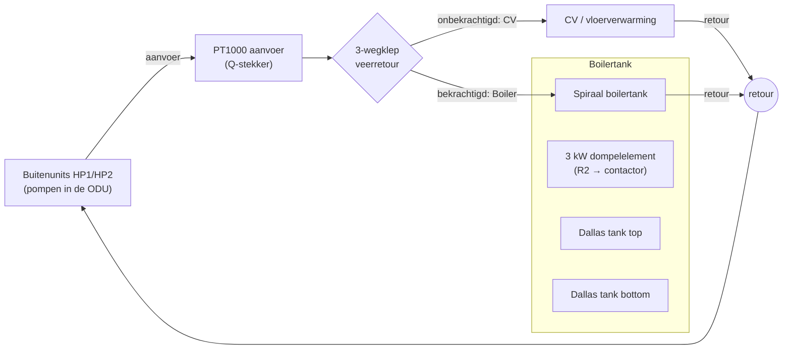
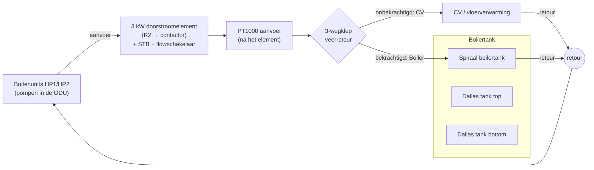
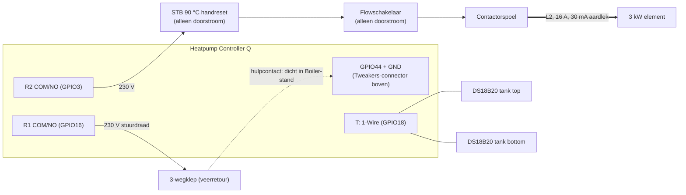

# Voorstel: plaats van het 3 kW-element (tank of doorstroom)

Status: fase A gebouwd (fe.15). Fase B volgt met een eigen voorstel.

**Besluiten (25-10):** 1 ja, 2 ja, 3 ja (fase B later), 4 ja (handleiding als Markdown met SVG en als PDF).

**Afwijking bij het bouwen:** de drie nieuwe instellingen (plaats, minimale flow, maximale aanvoer) worden los bewaard (9 NVS-entries), niet in het DHW-instellingenrecord. Ze bepalen de veiligheid van de elementsturing; zo is er geen recordmigratie nodig en kloppen ze direct na de start.

## Doel

FE ondersteunt twee opstellingen voor het 3 kW-element, te kiezen met een nieuwe instelling **"Plaats van het element"**:

| | **Tank** (dompelelement) | **Doorstroom** (vóór de 3-wegklep) |
|---|---|---|
| Waar | in de boilertank (dompelhuls of flens) | in de aanvoerleiding van de buitenunits, vóór de 3-wegklep |
| Verwarmt | alleen de boiler | de boiler via de spiraal (klep op Boiler); later optioneel ook de CV (fase B) |
| Flow nodig | nee | **ja, altijd** |
| Firmware nu | ondersteund (fe.14) | **niet veilig**: zie hieronder |

## Waarom de doorstroomvariant firmwarewerk vraagt

Nagelopen in fe.14:

1. **CM11 (alleen element)** zet de circulatiepompen uit (`oq_flow_runtime.h`: `flow_idle` voor CM0 en CM11). Met een doorstroomelement stookt het element dan op stilstaand water.
2. **Legionella met "coil circulation" uit** laat de klep in de elementfase terugvallen op CV. Er is dan geen warmwatervraag meer, de regeling valt naar CM0, de pompen gaan uit en het element staat aan.
3. **Boost na de warmtepomp** gaat al goed: in CM10 draaien de pompen op het DHW-flowsetpoint, ook met de compressor uit.

## Opstelling

### Tank

### Doorstroom

De PT1000-aanvoersensor komt in de doorstroomvariant **ná** het element. Zo ziet de Q de werkelijke aanvoertemperatuur en kan hij het element begrenzen.

## Elektrisch (beide varianten)

- **Contactor:** 230 V-spoel, hoofdcontact minimaal 20 A AC-1. Het element (13 A) zit op een **eigen groep op L2**, gescheiden van de buitenunits op L1.
- **Q-relais:** R1 en R2 schakelen alleen de klepmotor en de contactorspoel, nooit het element zelf.
- **Doorstroom:** STB (maximaalthermostaat, handreset, 90 °C) en flowschakelaar staan **hardwired in serie met de spoel**. Ze werken ook als de firmware faalt.
- **Tank:** de meeste dompelelementen hebben een eigen thermostaat en beveiliging. Die blijft in serie staan.

## Firmware (fase A: doorstroom voor warm water)

Nieuwe instellingen (Instellingen → Warm water):

| Instelling | Standaard | Bereik |
|---|---|---|
| Plaats van het element | Tank | Tank / Doorstroom |
| Minimale flow voor het element (doorstroom) | 400 L/h | 250–1000 L/h |
| Maximale aanvoertemperatuur element (doorstroom) | 75 °C | 60–85 °C |

Gedrag bij **Doorstroom**:

1. **Flowvergrendeling:** het element mag pas aan als de geselecteerde flow ≥ het minimum is, en dat **10 s aaneen**. Zakt de flow eronder, dan gaat het element **direct** uit, binnen één tick van 2 s.
2. **Temperatuurgrens:** het element gaat uit bij aanvoer (PT1000) ≥ het maximum, en pas weer aan bij ≤ het maximum − 5 K. Is de aanvoertemperatuur ongeldig, dan blijft het element uit.
3. **Klep op Boiler en pompen aan** zolang het element aan mag:
   - **CM11** wordt in deze variant geen pomp-uit-modus. De klep gaat naar Boiler, de pompen draaien op het DHW-flowsetpoint, en het element verwarmt de tank via de spiraal tot het doel op tank bottom.
   - **Legionella**: de elementfase houdt de klep altijd op Boiler, ongeacht "coil circulation".
4. **Nadraaien:** na het uitschakelen van het element blijven de pompen **60 s** draaien met de klep op Boiler, zodat de restwarmte uit het element wordt afgevoerd.
5. **Storing "Geen flow voor element":** dit is een nieuwe fout. Blijft de flow 60 s onder het minimum terwijl het element gevraagd wordt, dan gaat de regeling naar FAULT (latched). Een dichtgezeten filter of een pompstoring wordt zo zichtbaar.
6. **Bankproef:** de elementtest (R2) mag bij Doorstroom alleen met bevestigde flow. Op de bank kan dat niet: daar alleen de contactor zonder element testen.

Gedrag bij **Tank**: zoals nu (fe.14).

Testbaar maken: de vergrendeling, de temperatuurgrens en het nadraaien komen als pure functies in `oq_fe_dhw_levels_logic.h` of een nieuwe `oq_fe_element_logic.h`, met host-tests. Daar horen ook de grensgevallen bij: flow die precies op het minimum schommelt, een ongeldige PT1000 en een millis-overloop.

Upstream-haak: `oq_flow_runtime.h` maakt CM11 alleen flow-idle als Tank gekozen is.

## Fase B (later): doorstroomelement als CV-bijverwarming

Bij Doorstroom kan het element ook de CV bijverwarmen, met de klep op CV, via upstreams "Auxiliary heat source" (CM3 bijverwarmen, CM4 overnemen bij een warmtepompstoring). Dit vraagt eerst antwoord op:

- **Draaien de ODU-pompen in CM4** als de buitenunits in storing staan? Zonder flow mag het element niet aan, en CM4 is juist de storingsstand.
- Hoe verhoudt upstreams ketelregeling (vermogen, warmstartbeveiliging, OpenTherm) zich tot een element dat alleen aan/uit kan?
- Voorrang: warm water en CV-bijverwarming kunnen niet tegelijk (één element, één klepstand).

Fase B krijgt een eigen voorstel zodra fase A draait.

## Handleiding

Na akkoord op dit voorstel volgt `fe/handleiding-ombouw.md`:

- onderdelenlijst per variant;
- hydraulisch en elektrisch schema (SVG, printbaar);
- montage van de sensoren (dompelhulzen, PT1000 ná het element);
- afstellen van STB en flowschakelaar;
- de link naar `fe/ingebruikname-q.md`.

## Keuzes

1. Fase A bouwen zoals hierboven, met de standaarden 400 L/h, 75 °C, 10 s vergrendeling en 60 s nadraaien? **Advies: ja.**
2. Het nieuwe storingstype "Geen flow voor element" (latched na 60 s)? **Advies: ja.**
3. Fase B (CV-bijverwarming) later, met een eigen voorstel? **Advies: ja.**
4. De handleiding als Markdown met SVG-schema's in de repo, en daarnaast een printbare PDF?
