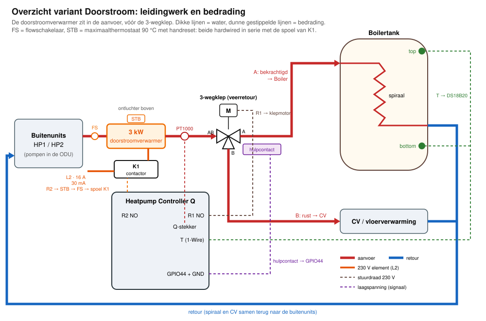
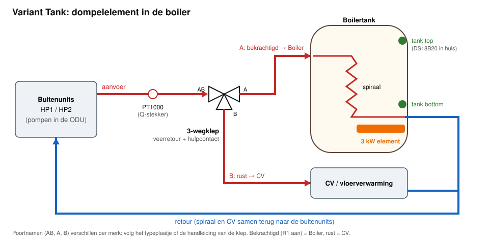
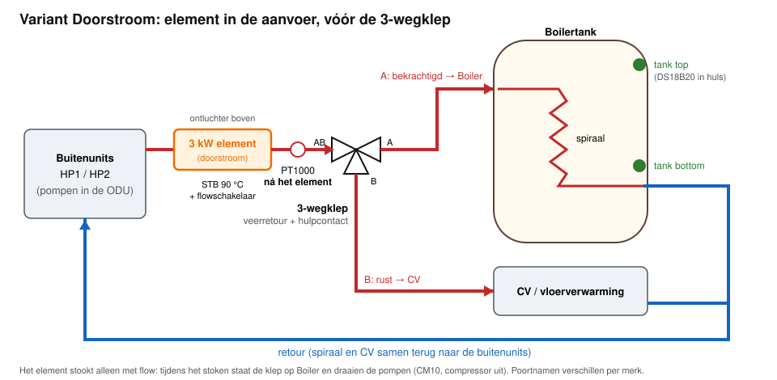
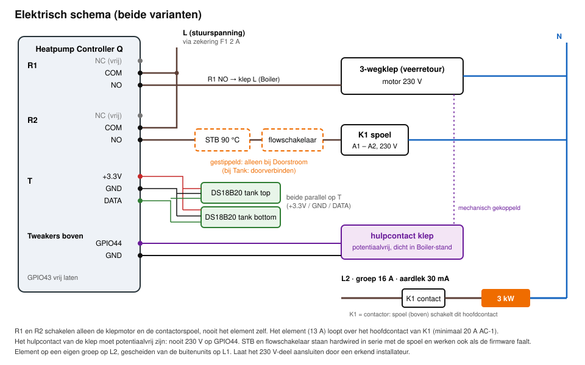

# Handleiding: ombouw naar OpenQuatt FE (Full Electric)

Deze handleiding beschrijft hoe je een Quatt-installatie met de Heatpump Controller Q ombouwt naar Full Electric: geen CV-ketel, wel een boilertank voor warm water met een 3-wegklep en een 3 kW-element. Voor het in gebruik nemen na de ombouw: zie [`ingebruikname-q.md`](ingebruikname-q.md).

> **Veiligheid.** Het 230 V-deel (klep, contactor, element, groep en aardlek) laat je aansluiten door een erkend installateur. Werk spanningsloos. Twijfel je over iets in deze handleiding, stop dan en vraag het na.

## 1. Kies je variant

| | **Tank** | **Doorstroom** |
|---|---|---|
| Element | dompelelement in de boilertank | doorstroomelement in de aanvoer, vóór de 3-wegklep |
| Verwarmt | alleen de boiler | de boiler via de spiraal; later optioneel ook de CV (fase B) |
| Flow nodig | nee | ja, altijd |
| Extra beveiliging | de thermostaat van het element | STB (90 °C, handreset) en flowschakelaar, hardwired |
| Instelling in de web-app | Warm water → Element → **Tank** | Warm water → Element → **Inline** |

Twijfel je? Kies **Tank**: eenvoudiger, en zonder afhankelijkheid van de pompen.

## 2. Onderdelen

**Voor beide varianten:**

- Heatpump Controller Q met FE-firmware **v0.54.1-fe.15 of nieuwer**.
- **Boilertank**, indirect gestookt (met spiraal), met twee **dompelhulzen**: één bovenin (tank top) en één onderin, net boven de spiraal (tank bottom).
- **Twee DS18B20-sensoren**, waterdicht, met voldoende kabel naar de Q.
- **3-wegklep, 230 V, met veerretour**: zonder spanning terug naar CV. Met een **potentiaalvrij hulpcontact** dat sluit in de Boiler-stand.
- **Contactor**: 230 V-spoel, hoofdcontact minimaal 20 A AC-1.
- **Eigen groep op L2**: automaat 16 A met aardlek 30 mA, gescheiden van de buitenunits op L1.
- **Zekering F1, 2 A**, voor de stuurspanning van klep en contactorspoel.

**Alleen bij Tank:**

- **Dompelelement 3 kW / 230 V**, met eigen thermostaat en beveiliging.

**Alleen bij Doorstroom:**

- **Doorstroomelement 3 kW / 230 V**, met ontluchting bovenaan.
- **STB (maximaalthermostaat), 90 °C, handreset**, op of direct na het element.
- **Flowschakelaar** in de aanvoer, schakelpunt rond 300–400 L/h.

## 3. Hydraulisch

### Overzicht Doorstroom: leidingwerk en bedrading samen

De doorstroomverwarmer zit in de aanvoer, vóór de 3-wegklep. De details staan in de schema's hieronder en in hoofdstuk 4.

### Tank

### Doorstroom

**Aandachtspunten:**

1. **3-wegklep:** de gemeenschappelijke poort (vaak `AB`) komt aan de aanvoer. De poort die **bekrachtigd** open is gaat naar de spiraal van de boiler, de poort in **rust** naar de CV. De poortnamen verschillen per merk: volg het typeplaatje of de handleiding van de klep.
2. **Spiraal:** de aanvoer komt bovenin, de retour onderin (tegenstroom). De retour van spiraal en CV komen samen terug naar de buitenunits.
3. **PT1000 aanvoer** (Q-stekker):
    - Tank: op de normale plek in de aanvoer.
    - Doorstroom: **ná het element**, vóór de klep. De Q begrenst het element met deze sensor.
4. **Doorstroomelement:** monteer het zo dat er geen lucht in blijft staan (ontluchter bovenaan). Zet de flowschakelaar in dezelfde leiding.
5. **Tanksensoren:** zet ze met warmtegeleidende pasta in de hulzen en zet de kabel vast, zodat de sensor niet uit de huls trekt.

## 4. Elektrisch

| Q-aansluiting | Klem | Naar |
|---|---|---|
| **R1** | `COM` | stuurspanning L via F1 (2 A) |
| | `NO` | klepmotor L (Boiler-stand). Klep-N naar N. `NC` blijft vrij |
| **R2** | `COM` | stuurspanning L via F1 (2 A) |
| | `NO` | → (STB → flowschakelaar, alleen bij Doorstroom) → contactorspoel A1. A2 naar N. `NC` blijft vrij |
| **T** | `+3.3V` / `GND` / `DATA` | beide DS18B20 parallel (rood / zwart / geel of wit, volg de kleurcode van je sensor) |
| **Tweakers-connector boven** | `GPIO44` + `GND` | hulpcontact van de klep. **Alleen potentiaalvrij**: nooit 230 V. `GPIO43` blijft vrij |

**Regels:**

- R1 en R2 schakelen alleen de klepmotor en de contactorspoel, **nooit het element zelf**.
- Het element (13 A) loopt over het hoofdcontact van de contactor, op de eigen groep op L2.
- STB en flowschakelaar staan **in serie met de spoel**. Ze werken dus ook als de firmware faalt.
- Bij Tank verbind je die twee posities door, of zet je er de thermostaat van het dompelelement in als die een stuurcontact heeft.

## 5. Firmware instellen

1. **Flash** `firmware.factory.bin` via USB (web.esphome.io), **met wissen**.
2. **Sensoradressen:** de firmware zoekt bij het opstarten de DS18B20's op `T`. De gevonden adressen staan onder Service → Bankproef warm water → **1-Wire-adressen**.
    - De adressen die de firmware gebruikt staan in `openquatt/fe/fe_io.yaml` (`fe_dallas_tank_top_address`, `fe_dallas_tank_bottom_address`).
    - **Andere sensoren dan die van de ontwikkelopstelling vragen een eigen build:** zet je eigen adressen als substitutions in `configs/heatpump_controller_q/duo_fe.yaml`.
    - Welke sensor top is, ontdek je door er één met de hand op te warmen.
3. **Instellingen → Warm water → Element:** kies **Tank** of **Inline**. Laat bij Inline de standaarden staan (minimale flow 400 L/h, maximale aanvoer 75 °C), tenzij de fabrikant van het element iets anders voorschrijft. De maximale aanvoer blijft altijd onder de STB-temperatuur.

## 6. Bankproef

Onder Service → **Bankproef warm water**:

1. **Test driewegklep (R1):** de klep loopt naar Boiler, en **Klepstand (terugmelding)** wordt `Boiler`. Uitzetten: terug naar `CV`.
2. **Test element (R2):** de contactor trekt aan.
    - Bij **Tank** alleen met water in de tank.
    - Bij **Inline** kan dit alleen met flow; zonder flow staat de status op *Niet toegestaan*. Test de contactor op de bank dan **zonder** aangesloten element.
3. **Tanksensoren:** warm er één met de hand op en controleer dat de juiste waarde stijgt.

Daarna verder met [`ingebruikname-q.md`](ingebruikname-q.md).

## 7. Wat de firmware doet

| Situatie | Tank | Doorstroom |
|---|---|---|
| Warmtepompcyclus (CM10) | klep op Boiler, compressoren op de tank | idem |
| Boost na de warmtepomp | element in de tank | element in de aanvoer, klep op Boiler, pompen aan (CM10, compressor uit) |
| Alleen element (CM11) | pompen uit, element op tank bottom | pompen aan zolang het element stookt, klep op Boiler |
| Legionella, elementfase | klep op Boiler of CV ("coil circulation") | klep altijd op Boiler, pompen aan |
| Element mag aan | met een bevestigde Boiler-stand | ook pas na 10 s flow ≥ minimum en bij een aanvoer onder het maximum |
| Na het element | – | 60 s nadraaien van de pompen |
| Geen flow | – | 60 s vraag zonder flow: storing **Geen flow voor element** |

## 8. Storingen

| Melding | Oorzaak | Wat te doen |
|---|---|---|
| Geen flow voor element | Inline: 60 s elementvraag zonder flow | pompen, filters en afsluiters controleren; daarna **Storing wissen** |
| Klepstand klopt niet / Klep blijft op CV | terugmelding wijkt af van de stuurstand | hulpcontact en bedrading op GPIO44 controleren; draait de klep echt? |
| Tanksensor onbetrouwbaar | DS18B20 ontbreekt of geeft een onmogelijke waarde | 1-Wire-adressen controleren; sensor en kabel nalopen |
| Element blijft uit (Inline) | aanvoer ≥ maximum of ongeldig, of te weinig flow | PT1000 ná het element? Flowsetpoint DHW ≥ minimale flow? |
| Element blijft uit (STB) | de STB is afgeslagen | oorzaak zoeken (lucht, geen flow), daarna de handreset op de STB |
